<!-- Hello, source reader. Yes, I use Gentoo, btw. This README finished compiling before my kernel did. -->

### Mechanical Engineer · Energy Systems · Solar PV & BESS · Climate Policy

---

## About Me

I'm a mechanical engineer working on Indonesia's energy transition, with professional experience spanning hospitality revenue analytics, solar PV project development, battery energy storage research and carbon accounting. I'm currently pursuing a Master of Energy Systems at the University of Melbourne.

I specialise in energy system modelling and techno-economic analysis, hold the PVsyst for Engineer and Level 3 Senior Solar PV Installer and Operator certifications, and write on ASEAN renewable energy policy, carbon pricing and the environmental impact of mining. You can read my essays on [my website](https://tirtawijata.com) and [Medium](https://medium.com/@marcelbonifaciotirtawijata).

  

---

## Tech Stack

<!-- TODO: rewrite this README in Rust. Estimated compile time on Gentoo: yes. -->

**Languages**

**Frameworks and Libraries**

**Energy, Data and Engineering Tools**

---

## GitHub Activity

  

---

## Let's Connect

